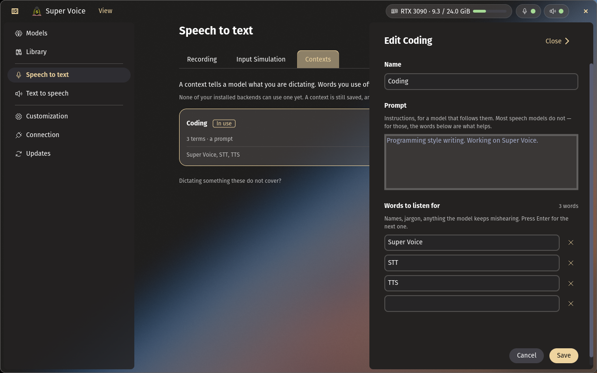

<div align="center">


# Super Voice

**Speak into any app on Linux, and hear any text read aloud.**

*One shortcut to dictate anywhere • Natural voices, or clone your own • Any model from a growing library • An open protocol any app can build on • Built in Rust*

[](https://jorge-menjivar.github.io/super-voice/coverage/)

</div>

https://github.com/user-attachments/assets/bbbe20c3-6802-4797-afc8-aa81d1b48415

## 🚀 Installation

**Quick install** - detects your system and downloads pre-built binaries:

```bash
curl -sSL https://raw.githubusercontent.com/jorge-menjivar/super-voice/main/install.sh | bash
```

Append `-s -- --beta` for the latest beta.

## What is Super Voice?
Super Voice is speech-to-text and text-to-speech for Linux, with any model you want. Dictate into any app, hear text read aloud, and swap models anytime, local or cloud, on CPU or GPU.

Under the hood it's two things:

- **A model-agnostic engine.** A background daemon installs speech models from a **library** of backends (local or cloud), loads one, and keeps it warm for instant transcription. You pick the model that fits your hardware and swap it whenever you like.
- **An open protocol.** The daemon speaks a documented HTTP protocol over a local socket, so *any* app, in any language, can request transcriptions, stream live audio visualizations, or drive recording, with per-app consent. Super Voice's own desktop apps, CLI, and COSMIC applet are just the first clients. See [Developers](#-developers).

## Features?
- Speech-to-Text support.
- Text-to-Speech support.
- High performance. Built in Rust. Supports GPU acceleration for both STT and TTS.
- Native support for Linux.
- Bind a shortcut (Super+Space by convention), speak, and your words are typed straight into whatever app is focused, e.g. your editor, browser, chat, terminal. No copy-paste, no fiddling.
- It allows you to speak text (synthesize) high quality audio using state-of-the-art models without any extra setup.
- Clone your own voice and use it to speak text.
- You can choose the model to use from a growing library of backends. You can [create and use your own backend](./docs/protocol/README.md#add-your-own-model) too.


## ⌨️ Using it

Open **Super Voice** from your app launcher. Everything starts there:

1. **Models:** pick a model for speech to text and one for text to speech, or install one from **Library → Browse**.
2. **Speech to text → Recording:** press **Test Recording**, speak, and the transcription appears in the app.
3. **Text to speech → Speech:** type something and press **Speak** to hear it.
4. **Text to speech → Voices:** record or import a sample to clone your own voice.
5. **Speech to text → Contexts:** say what you're dictating and list the words it should get right, like names and product terms.

### Dictate anywhere with a shortcut

Press **Super+Space**, speak, and your words are typed into whatever app is focused: your editor, browser, chat or terminal. Add it from the app's **Shortcuts** page, on COSMIC or on a desktop with the GlobalShortcuts portal, such as KDE Plasma, GNOME or Hyprland. On any other, such as Sway, the page shows the command to bind yourself: `voice record --write`.

1. The shortcut asks the daemon to start transcribing from your mic.
2. You speak, and the daemon transcribes your audio.
3. When you stop, on silence or by pressing the shortcut again, it types the transcription into the focused app.

### From the command line

The shortcut runs the `voice` command, which you can also use directly:

```bash
voice record --write   # Record and transcribe. Types the result after silence, or when you run it again.
voice speak "Hello"    # Speak text with the loaded model. `voice speak stop` stops it.
```

Manage the daemon with the usual systemd controls:

```bash
systemctl --user start super-voice      # or: enable / status / restart
journalctl --user -u super-voice -f     # follow logs
```

## 🤖 Models

Models come from a **library** of backends you install on demand. Open the app, go to **Library → Browse**, install a backend, and it appears in the model selector. Some run **locally** (your audio never leaves your machine); others are **online** providers you reach with your own API key.

> **GPU acceleration** is a property of the model, not a separate build of the app. Install a GPU-capable backend (like Voxtral or Qwen3-ASR) and the daemon downloads the build matched to your GPU automatically. You just need an up-to-date driver.

### Free a model's memory when idle

By default a selected model stays loaded, so every request is answered at once. To keep it in memory only while you use it, turn on **Customization → Memory → Unload Idle Models** in the app and pick how long a model may sit unused.

The speech-to-text and text-to-speech models are then unloaded after that long without use, and loaded again by the next recording or `voice speak`, which waits for the load. Unloading a model yourself still switches it off until you load it again.

Want a model that isn't there? Anyone can [publish one](./docs/protocol/README.md#add-your-own-model).

## 🖼️ Screenshots

<table>
<tr>
<td align="center"><strong>Models</strong><br>Pick a model for each feature, and where it runs.<br></td>
<td align="center"><strong>Library</strong><br>Install backends, local or cloud.<br></td>
</tr>
<tr>
<td align="center"><strong>Contexts</strong><br>Teach it the words you use.<br></td>
<td align="center"><strong>Voices</strong><br>Clone a voice from a short recording.<br></td>
</tr>
</table>

## 🩺 Troubleshooting

- **`voice: command not found`**: binaries are installed system-wide and are on `PATH` by default — restart your terminal so it rehashes, and check the installer finished without errors.
- **Daemon won't start / misbehaves**: check `journalctl --user -u super-voice -n 50`.
- **Transcriptions seem less accurate than they should be**: your microphone input volume may be set too high or too low. Adjust the mic volume in your system sound settings and try again.
- **Typing doesn't work in some apps**: [`ydotool`](https://github.com/ReimuNotMoe/ydotool) types reliably across virtually all apps. Install it via your package manager, then try it out first by running `sudo ydotoold --socket-path="$HOME/.ydotool_socket" --socket-own="$(id -u):$(id -g)"` in a terminal and setting the write method to **ydotool** in Settings. If that fixes typing, make it permanent by enabling the service (e.g. `systemctl --user enable --now ydotool`).

## 🧑‍💻 Developers

Super Voice is built to be built on. The details live in developer-facing docs:

- **Build a client** — get transcriptions, event streams, or recording control into your own app, in any language, over the documented HTTP protocol → **[docs/protocol/](./docs/protocol/)**, with every endpoint in the **[API reference](https://jorge-menjivar.github.io/super-voice/protocol/)**
- **Add your own model** — package a speech model as a backend the daemon can install and run, then publish it to the catalog → **[docs/protocol/](./docs/protocol/)** and **[registry/README.md](./registry/README.md)**
- **Contribute** — build from source, workspace layout, and the PR workflow → **[CONTRIBUTING.md](./CONTRIBUTING.md)**

Architecture and the security model live in **[docs/](./docs/)**.

---

<div align="center">

**Jorge Menjivar** • jorge@menjivar.ai

</div>
