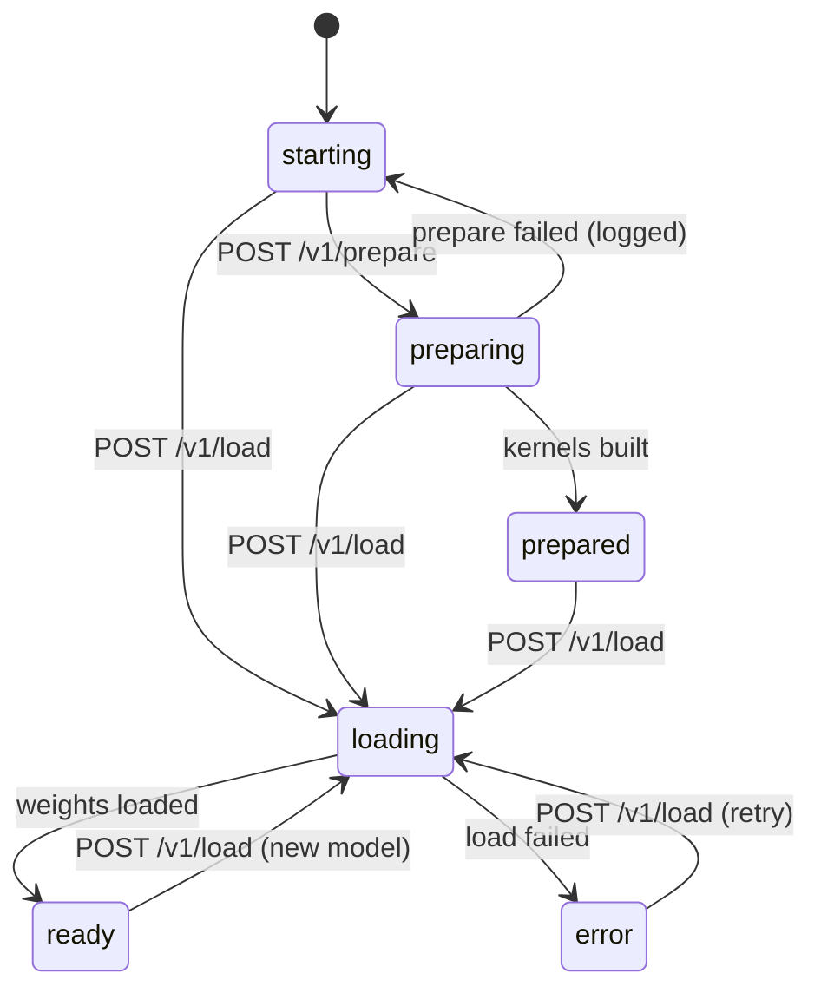
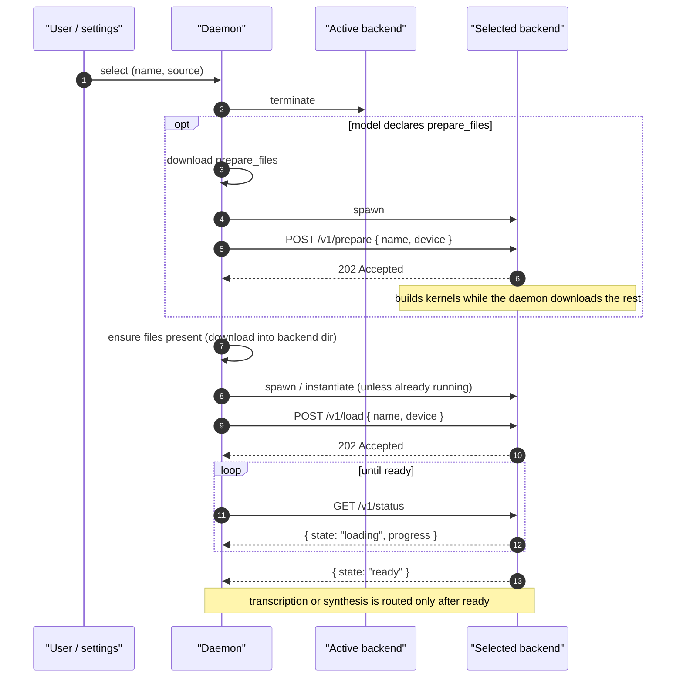

# Backend Protocol

A **backend** is an out-of-tree speech-to-text or text-to-speech
implementation that the daemon loads at runtime instead of compiling in. This
document defines the daemon↔backend contract that every backend implements,
regardless of how it is packaged. One backend may serve both features: each
model's [`role`](./config.md#model-roles) says which one it is for.

The contract is HTTP-shaped and identical for all backends. Only the
*transport* differs: a backend ships either as a WASM component the daemon
invokes in-process, or as a native subprocess the daemon spawns and talks to
over a Unix socket. Authors pick the transport; the routes, payloads, and
lifecycle below do not change.

This document is the companion to:

- [config.md](./config.md) — the `backend.toml` every
  backend ships, and the fields the daemon reads to discover it.
- [wasm.md](./wasm.md) — WASM component backends (cloud /
  API, lightweight CPU).
- [subprocess.md](./subprocess.md) — native subprocess
  backends (local models, GPU).
- [transport.md](../transport.md) — the external client↔daemon wire shape,
  which the backend contract mirrors.

## Model identity

A model is identified by the `(name, source)` pair — the same
pair external clients use on
[`/stt/pipeline/1/model`](../endpoints/v1/pipeline/model.md) and
[`/tts/pipeline/1/model`](../endpoints/v1/tts/pipeline/model.md):

| Field      | Type   | Notes                                                                       |
|------------|--------|-----------------------------------------------------------------------------|
| `name`     | string | Wire model name, e.g. `whisper-tiny`, `voxtral-mini`, `kokoro-82m`, `xtts-v2`, `nova-3`. |
| `source`   | string | The **backend repository** that provides the model — a canonical repo id declared in the backend's configuration. |

`source` names *which backend* a model comes from. Two backends may both
implement `whisper-tiny`, or both `kokoro-82m`; they coexist and are
disambiguated by `source`. The daemon derives a model's `source` from the
`[backend].source` field of the configuration that declares it — see
[config.md](./config.md).

> `source` supersedes the older `builtin | custom | online` discriminator.
> [pipeline.md](../endpoints/v1/pipeline.md),
> [pipeline/model-list.md](../endpoints/v1/pipeline/model-list.md),
> [tts/pipeline/model.md](../endpoints/v1/tts/pipeline/model.md) and
> [tts/pipeline/model-list.md](../endpoints/v1/tts/pipeline/model-list.md) are
> reconciled with this definition.

> `[backend].id` is a separate identifier that names a backend's install
> directory. It is not part of model identity.

## Transports

| Concern             | WASM backend                            | Subprocess backend                       |
|---------------------|-----------------------------------------|------------------------------------------|
| Use for             | Cloud / API models, light CPU work      | Local models, GPU inference              |
| Delivery            | In-process component invocation         | HTTP/SSE over a pathname Unix socket     |
| Contract exposure   | Exports `wasi:http/incoming-handler`    | Serves the `/v1` routes as an HTTP server |
| Network egress      | `wasi:http/outgoing-handler`, allowlisted | None — the process is network-isolated  |
| Sandbox             | wasmtime capability model               | systemd hardening + seccomp              |
| Specification       | [wasm.md](./wasm.md)            | [subprocess.md](./subprocess.md) |

Both deliver the same `/v1` request/response payloads. A WASM backend
receives an HTTP `Request` by direct in-process invocation; a subprocess
backend receives it over its socket. Nothing else about the contract
changes.

## The `/v1` contract

Every backend exposes these routes under the `/v1` prefix. Payloads follow
the envelope convention from [transport.md](../transport.md): responses carry
a top-level `status` field of `"success"` or `"error"`. These are the
backend's own routes, and they carry no `/stt` or `/tts` prefix. Only the
daemon's client-facing routes do.

| Method | Route                | Served for                        | Purpose                                            |
|--------|----------------------|-----------------------------------|----------------------------------------------------|
| POST   | `/v1/load`           | every model                       | Load a model variant; drives readiness to `ready`. |
| POST   | `/v1/prepare`        | models declaring `prepare_files`‡ | Build what a first load needs before the weights arrive. |
| GET    | `/v1/status`         | every model                       | Readiness state and load progress.                 |
| GET    | `/v1/ping`           | every model                       | Liveness.                                          |
| POST   | `/v1/cancel`         | `transcription`, `synthesis`      | Cancel an in-flight transcription or synthesis.    |
| POST   | `/v1/transcribe`     | `transcription`                   | Transcribe audio; one-shot or streaming.           |
| POST   | `/v1/process`        | `post_processor`                  | Rewrite a finished transcript.                     |
| POST   | `/v1/synthesize`     | `synthesis`                       | Synthesize speech; streams framed audio.           |
| POST   | `/v1/voices`         | `synthesis`, cloned voices†       | Register a cloned voice's reference audio.         |
| DELETE | `/v1/voices/{voice}` | `synthesis`, cloned voices†       | Release a registered cloned voice.                 |

† Only for models declaring `cloned` in
[`voice_kinds`](./config.md#voices). A backend whose models are all preset or
described never receives these calls and need not implement them.

‡ Only for models declaring [`prepare_files`](./config.md#models). A backend
whose models declare none never receives it and need not implement it.

The routes for each role are described under
[Speech to text](#speech-to-text) and [Text to speech](#text-to-speech) below.
The rest of this section is shared by every role.

### Contract generations and the `/v1` prefix

The manifest's [`contract`](./config.md#contract-generations) names a
*generation* of this agreement — which fields a `backend.toml` may declare
and which routes exist to be served. Each generation extends the last: `v2` is
`v1` plus `[[models]].role` and `POST /v1/process`, and `v4` adds
`POST /v1/prepare` and text to speech. The table is in
[contract generations](./config.md#contract-generations).

A generation does not oblige a backend to serve all of it. What a backend must
implement follows from the models it declares, not from the generation it
names:

1. A backend serving only `post_processor` models implements
   `POST /v1/process` and never `POST /v1/transcribe`.
2. A backend whose models are all preset or described serves
   `POST /v1/synthesize` and never `POST /v1/voices`, and is no less a `v4`
   backend for it.

The `/v1` in the route paths is not that number. It is a path segment inside
the agreement, and an extending generation leaves it alone: a `v2` backend
serves `/v1/process` next to `/v1/transcribe`, and renames nothing. The prefix
would move only for a generation that changed the shape of a route that
already exists, which none has.

### Request headers

On every `/v1` request the daemon injects context as request headers; a
backend reads what it needs and ignores the rest. The daemon owns these
headers — external clients cannot set them.

| Header                  | Carries                                                                       |
|-------------------------|-------------------------------------------------------------------------------|
| `x-voice-model`         | The active model name, e.g. `whisper-1` or `kokoro-82m`.                      |
| `x-voice-secret-<name>` | One declared secret, e.g. `x-voice-secret-OPENAI_API_KEY`.                    |
| `x-voice-option-<name>` | One declared option, e.g. `x-voice-option-base_url`.                          |
| `x-voice-prompt`        | Speech to text only. The user's dictation prompt, as a JSON string.           |
| `x-voice-vocabulary`    | Speech to text only. The user's vocabulary terms, as a JSON array of strings. |

Backends built before these names read the same headers under the prefix of
the model's feature: `x-stt-` for a `transcription` or `post_processor` model,
`x-tts-` for a `synthesis` model. The daemon sends every header under both
names, so `x-stt-model` and `x-voice-model` carry the same value. Read the
`x-voice-*` names.

- `x-voice-model` names the model to transcribe or synthesize
  with. The daemon also calls [`POST /v1/load`](#post-v1load) with the model
  before routing, but a stateless backend (re-instantiated per request — see
  [wasm.md](./wasm.md)) reads the model header on each request instead of
  remembering the load; a stateful backend may rely on `load` and ignore the
  header.
- Secrets and options come from the backend's [configuration](./config.md),
  with values set by the user in the settings UI. The header for a secret or
  option the user has not set is omitted.
- An option value is refused before it is stored if a header cannot carry it:
  over 4000 characters, or containing a control character. So a backend reading
  an option header gets a single line, always, and the daemon has already said
  no to the user rather than handing the backend something its transport will
  reject.
- The `base_url` option header (`x-voice-option-base_url`) is the one the
  daemon normalizes. It carries a
  canonical `scheme://host[:port][/path]`:
  lowercase scheme, no userinfo, no trailing slash, no query or fragment, and a
  port only when the user set one. A backend can split it at the first `/`
  after the scheme and needs no further parsing. Every other option is passed
  through exactly as the user set it. See
  [config.md — `base_url` and egress](./config.md#base_url-and-egress).
- **Secret values are sensitive.** The daemon stores them in a file only the
  user can read (see [Security model](#security-model)) and redacts the
  `x-voice-secret-*` headers from logs. A backend uses a
  secret only to authenticate its own outbound calls — it must never echo one
  in a response or forward the injected header upstream. An OpenAI backend
  reads `x-voice-secret-OPENAI_API_KEY` and sets its own `Authorization: Bearer` header on the request
  to `api.openai.com`.
- Option values are not sensitive and are stored as plaintext.

The dictation context is speech to text's alone:

- `x-voice-prompt` and `x-voice-vocabulary` carry the
  [dictation context](../endpoints/v1/context.md) the user has in force for this
  backend: what they are dictating, so the model can hear it. They are sent
  **only** to a backend declaring `[capabilities] context = true`, and each is
  omitted when its half is empty — a backend using one and not the other never
  has to tell "absent" from "empty". The user can point one backend at a
  different context, or at none, so two backends may receive different values on
  the same request.
- Both are **JSON**, and both are escaped to pure ASCII. A prompt holds line
  breaks and a vocabulary is a list, and a header value can carry neither as
  itself. Decode with the JSON parser you already have:
  `x-voice-prompt` is a string, `x-voice-vocabulary` an array of strings. Non-ASCII
  characters arrive as `\uXXXX` escapes and come back out of that parser as
  themselves, so nothing extra is needed to read a prompt written in Spanish.
- The vocabulary is an **array** because every model wants it differently —
  Deepgram takes one `keyterm=` per term, `whisper-1` takes them joined — and a
  term containing whatever delimiter a flat string chose, like
  `Menjivar, Jorge`, would be ambiguous. Join or iterate as your upstream needs;
  the daemon has already split it.
- Each upstream has its own ceiling (`whisper-1` 224 tokens, Deepgram 500) that
  the daemon does not know. A backend that cares should truncate rather than let
  the request fail. The daemon's own limits only stop a runaway value from being
  stored: 4000 characters for the prompt, 200 terms or 4000 characters for the
  vocabulary.
- Neither header requires a reload to change. They are re-injected on the
  running instance when the user edits a context, so the next request carries
  the new value. A realtime session is the exception, and only because of when
  it reads them: `ws-server.handle` is handed the headers once, at the start of
  the session, so a context edited mid-recording applies to the next session
  rather than the one in flight.

### `POST /v1/load`

Load one model variant. The daemon has already provisioned the model's files
into the backend's directory (see [Lifecycle](#lifecycle)); the backend
resolves them from the `dest` paths in its own configuration. The call returns
`202` immediately and the load proceeds asynchronously — progress is read
from [`GET /v1/status`](#get-v1status).

A backend serves exactly one model at a time. Switching models is a fresh
`load` after the daemon has torn the backend down and spawned it again.

**Every backend must implement `/v1/load`.** A backend with nothing to load —
e.g. a cloud backend that holds no local weights — treats it as a no-op: it
acknowledges with `202` and reports `ready` from `GET /v1/status` immediately.
The daemon always calls `load` before routing transcription or synthesis, so
the route must exist even when it does no work.

**Request:**

```http
POST /v1/load HTTP/1.1
Host: backend.local
Content-Type: application/json

{
  "name":     "whisper-tiny",
  "device":   "cuda"
}
```

| Field      | Type   | Required | Notes                                                          |
|------------|--------|----------|----------------------------------------------------------------|
| `name`     | string | yes      | A model `name` the backend declares in its configuration.           |
| `device`   | string | no       | The resolved accelerator for this load: `cpu`, `cuda`, `rocm`, `metal`, or `vulkan`. This is the accelerator the installed asset actually targets, not the user's `cpu`/`gpu` preference — the daemon resolves that preference against the asset it selected, so a build carrying more than one runtime is told which one to use. The same resolution is what external clients see as `resolved_accel` on a model's device, at [`/stt/pipeline/{stage}/model/{model}/device`](../endpoints/v1/pipeline/device.md#get-sttpipelinestagemodelmodeldevice) or [`/tts/pipeline/{stage}/model/{model}/device`](../endpoints/v1/tts/pipeline/device.md#get-ttspipelinestagemodelmodeldevice). **Absent** when the daemon has no record of which accelerator the installed build targets — an install performed from a local directory, for instance — in which case the backend selects for itself. The backend may still fall back; the actual device is reported by `GET /v1/status`. |
| `provider` | string | no       | Present only when the model declares [`provider`](./config.md#models) in its configuration, echoed back verbatim. Carries no meaning to the daemon. |

> **Compatibility.** `provider` was part of model identity before it became
> `(name, source)`. Backends released against the earlier contract reject a
> load whose `provider` does not match their own fixed value, so the daemon
> still forwards the key for any model whose manifest declares it. A new
> backend should ignore it: identity is `name`, and the daemon spawns one
> backend per model.

**Response (202):**

```http
HTTP/1.1 202 Accepted
Content-Type: application/json

{ "status": "success", "message": "Loading started" }
```

**Errors:**

| HTTP | `message`            | Meaning                                                       |
|------|----------------------|---------------------------------------------------------------|
| 400  | `invalid_model`      | `name` is not implemented by this backend.                    |
| 409  | `already_loading`    | A load is already in progress.                                |
| 503  | `device_unavailable` | The requested device cannot be initialized.                   |

### `POST /v1/prepare`

Do the one-off part of a first load before the weights arrive. A backend that
builds GPU kernels on its first load can build them from the model's
configuration alone, because kernels depend on shapes and dtypes, never on
weight values. The daemon overlaps that build with the download of the
weights, and the load that follows is an ordinary one.

The daemon sends it only for a model that declares
[`prepare_files`](./config.md#models), and only once those files are on disk.
The weights are still downloading, so the prepare may read only the files
`prepare_files` lists. Declaring the field is the promise that the backend
serves this route for that model.

The request body is the same as [`POST /v1/load`](#post-v1load)'s. The call
returns `202` at once and the prepare runs in the background;
[`GET /v1/status`](#get-v1status) reports it as `preparing`, then `prepared`.

**Response (202):**

```http
HTTP/1.1 202 Accepted
Content-Type: application/json

{ "status": "success", "message": "Preparing started" }
```

It is also `202` when the work is already done, such as kernels cached by an
earlier prepare or load, and the state then goes straight to `prepared`. A
prepare of the same model that is already running is left alone, and the
answer is `202` too.

**Errors:**

| HTTP | `message`         | Meaning                                                           |
|------|-------------------|-------------------------------------------------------------------|
| 400  | `invalid_model`   | `name` is not implemented by this backend.                        |
| 409  | `already_loading` | A load is in progress or done. A prepare only helps before the load. |

A prepare is best effort, and its failure must never fail the load:

- A prepare that fails returns the state to `starting` and logs why, with no
  `reason`. Nothing is wrong with the backend: its load does the whole first
  load itself, as it would have without the prepare. Catch a panic where the
  prepare runs, as for a load.
- `POST /v1/load` may arrive while the prepare runs. Answer `202` at once and
  report `loading`. Finish the prepare as part of the load, carrying on its
  `phase`, `step` and `progress`, then load as usual. Free the memory the
  prepare held before the weights go onto the device, so the load peaks no
  higher than it would alone.
- The daemon does not wait for `prepared`, and does not poll
  `GET /v1/status` while the weights download. It sends `POST /v1/load` when
  the download finishes. A backend process that exits during the prepare is
  started again before that load.

### `GET /v1/status`

Report readiness. `state` is the backend's readiness; `status` is the
envelope outcome — they are distinct: `status` is `"success"` whenever the
status report itself is valid, even while `state` is `"loading"` or
`"error"`.

**Request:**

```http
GET /v1/status HTTP/1.1
Host: backend.local
```

**Response (200):**

```jsonc
{
  "status":   "success",   // envelope outcome: "success" | "error"
  "state":    "loading",   // readiness: "starting" | "preparing" | "prepared" | "loading" | "ready" | "error"
  "phase":    "initial_setup",    // optional, while loading or preparing: "initial_setup" | "loading"
  "step":     "building_kernels", // optional, while loading or preparing: see below
  "progress": 0.42,        // optional, while loading or preparing: 0.0–1.0 through `step`
  "model": {               // present once a load has been requested
    "name": "whisper-tiny"
  },
  "device":   "cuda",      // actual device in use: "cpu" | "cuda" | "rocm" | "metal" | "vulkan"
  "reason":   null         // machine-readable cause; set when state == "error"
}
```

| Field      | Type    | Notes                                                                       |
|------------|---------|-----------------------------------------------------------------------------|
| `state`    | string  | `starting` (spawned, no load yet), `preparing` or `prepared` (a [prepare](#post-v1prepare) running or done), `loading`, `ready`, or `error`. |
| `phase`    | string? | While `loading`: `initial_setup` for a first load that pays a one-time cost (building GPU kernels, say), `loading` otherwise. While `preparing`: `initial_setup`. |
| `step`     | string? | While `loading`: what the load is doing, `loading_weights`, `building_kernels` or `warming_up`. While `preparing`: `building_kernels`. |
| `progress` | number? | While `loading` or `preparing`: how far through `step` the work is, `0.0`–`1.0`, or through the whole load when there is no `step`. |
| `model`    | object? | The model being loaded or loaded; absent in `starting`.                     |
| `device`   | string? | Device actually in use, one of `cpu`, `cuda`, `rocm`, `metal`, `vulkan`; present once `ready`. |
| `reason`   | string? | Machine-readable failure cause; present only when `state` is `error`.       |

`phase`, `step` and `progress` are how a load says what it is doing. The
daemon passes them to its clients, which show a first load as "Initial setup"
with the step and a bar under it, where they would otherwise show one
unchanging line for however long the load takes. All three are optional, and
a backend that sends none still loads. A prepare reports them the same way,
and under the same rules, since a load that arrives during it carries them
on. When sending them:

- Send ids, not text. The daemon passes on only lowercase letters, digits and
  underscores, and each client words the ids itself. An id a client does not
  know is shown as a load in progress.
- Keep `progress` rising within a step and below `1.0` until the step ends.
  It starts again from `0.0` when `step` changes.
- Once you have sent `progress` in a load, change `step` or `progress` at
  least once a minute until the load ends. The daemon fails a load whose
  report has not moved in two minutes, with the backend's recent output, and
  does not hold it to the ten-minute load budget otherwise, so a slow load
  that keeps moving is never cut off. Count the small units of the work so
  the value keeps moving: compiled kernels as well as tuning results, bytes
  or tensors for `loading_weights`.

`state` transitions:



A load that fails must end in `error` with a `reason`, however it failed: a
returned error, a panic, a thread that died. Catch a panic where the load
runs rather than letting it end the loading thread quietly. A backend left
reporting `loading` after its load can no longer finish gives the daemon
little to act on: it waits out its ten-minute load budget, or two minutes
without movement if the backend has reported `progress`, then fails the
load with the backend's recent output. A backend that exits mid-load fails
the load at the daemon's next poll, with the same output.

The daemon routes transcription or synthesis to a backend only while `state`
is `ready`.

### `GET /v1/ping`

Liveness. A successful response means the backend is running and serving the
contract; it says nothing about whether a model is loaded — use
`GET /v1/status` for that.

**Response (200):**

```http
HTTP/1.1 200 OK
Content-Type: application/json

{ "status": "success", "message": "pong" }
```

### `POST /v1/cancel`

Cancel the in-flight transcription or synthesis, if any. The corresponding
response terminates:

1. A `/v1/transcribe` response ends, a streaming one with an `event: error` or
   by closing.
2. A `/v1/synthesize` response ends with an `error` frame if the body has
   already started, or by closing.

Returns `409 nothing_in_progress` when nothing is running.

**Response (200):**

```http
HTTP/1.1 200 OK
Content-Type: application/json

{ "status": "success", "message": "Cancelled" }
```

## Speech to text

The routes a `transcription` or `post_processor` model serves.

### `POST /v1/transcribe`

Transcribe audio the daemon has already captured. Backends never touch a
microphone; the daemon owns capture and always passes samples in
`audio_data`. The route returns a one-shot JSON result, or — when
`options.stream_realtime` is `true` — a Server-Sent Events stream of
`preview` frames followed by a final `done`, mirroring
[transcribe.md](../endpoints/v1/transcribe.md).

**Request:**

```jsonc
{
  "audio_data":  [0.012, -0.034, …],  // f32 PCM samples, required
  "sample_rate": 16000,               // Hz
  "language":    "en",                // optional; must be in supported_languages
  "options": {
    // Emit incremental `event: preview` frames before the final
    // `event: done`. Default: false.
    "stream_realtime": true
  }
}
```

| Field         | Type    | Required | Notes                                                  |
|---------------|---------|----------|--------------------------------------------------------|
| `audio_data`  | array   | yes      | f32 PCM samples.                                        |
| `sample_rate` | number  | no       | Default `16000`.                                        |
| `language`    | string  | no       | BCP-47 transcription language tag (e.g. `en`, `es-MX`, `es-419`) **or** the reserved `auto` (auto-detect). Permitted only for multilingual models; a non-`auto` tag must be one of the model's `supported_languages`. When omitted, the model's `primary_language` is used. |
| `options`     | object  | no       | Per-request options; currently `stream_realtime`.       |

The reserved value `language: "auto"` requests auto-detection: the backend maps
it to its native mechanism (e.g. Deepgram `multi`, Whisper detect-from-audio)
and falls back to the model's `primary_language` if it cannot. Backends MUST
accept `auto` without error; it is never rejected with `unsupported_language`.

**Response — one-shot (200):**

```http
HTTP/1.1 200 OK
Content-Type: application/json

{ "status": "success", "transcription": "hello world" }
```

**Response — streaming (200):** a `text/event-stream` carrying zero or more
`preview` frames then one `done`:

| `event:`  | `data:` payload                      | When                                              |
|-----------|--------------------------------------|---------------------------------------------------|
| `preview` | `{ "text": "hello wor…" }`           | Incremental result while decoding continues.      |
| `done`    | `{ "transcription": "hello world" }` | Final transcription; the stream closes after it.  |
| `error`   | `{ "message": "..." }`               | Fatal error before `done`; the stream then closes. |

**Errors:**

| HTTP | `message`               | Meaning                                                       |
|------|-------------------------|---------------------------------------------------------------|
| 400  | `invalid_audio`         | `audio_data` is missing or empty.                             |
| 400  | `unsupported_language`  | `language` is not in the model's `supported_languages`.       |
| 409  | `not_ready`             | No model is loaded; check `GET /v1/status`.                   |
| 500  | `inference_failed`      | The backend failed during inference.                          |

Once a streaming response has started, late errors arrive as an in-stream
`event: error` frame followed by the connection closing.

### `POST /v1/process`

Rewrite a finished transcript — filler removal, punctuation, capitalization,
formatting. This is the **post-processor** route: it is served by models the
backend declares with [`role = "post_processor"`](./config.md#model-roles), and
the daemon drives such a model over this route instead of `/v1/transcribe`.

The daemon never sends audio here and never sends transcripts to a
transcription-role model, so a backend that provides no post-processor need not
implement the route at all.

A post-processor loads exactly like a transcription model — the daemon calls
`POST /v1/load` and waits for `ready` before routing any text — and reads its
configuration from the same injected [request headers](#request-headers). How
the rewrite is performed, and what knobs the user gets (a style prompt, a
temperature, a model endpoint), is entirely the backend's own business,
declared through its [`[[options]]` and `[[secrets]]`](./config.md#options).

**Request:**

```jsonc
{
  "text":     "um so i think we should uh ship it",  // required
  "language": "en"                                   // optional
}
```

| Field      | Type   | Required | Notes                                                                  |
|------------|--------|----------|------------------------------------------------------------------------|
| `text`     | string | yes      | The transcript to rewrite. Never empty — the daemon skips the call for an empty transcript. |
| `language` | string | no       | BCP-47 tag the transcript was produced in, so the backend punctuates in the right language. Resolved the same way as on `/v1/transcribe`; omitted when the daemon has none. |

**Response (200):**

```http
HTTP/1.1 200 OK
Content-Type: application/json

{ "status": "success", "text": "So I think we should ship it." }
```

| Field  | Type   | Notes                                                        |
|--------|--------|--------------------------------------------------------------|
| `text` | string | The rewritten transcript. Returning `text` unchanged is a valid answer — it means "nothing to clean up". |

There is no streaming form: post-processing runs on a transcript the user has
already finished dictating, and the daemon delivers the result in one piece.

**Errors:**

| HTTP | `message`           | Meaning                                                     |
|------|---------------------|-------------------------------------------------------------|
| 400  | `invalid_text`      | `text` is missing or empty.                                 |
| 409  | `not_ready`         | No model is loaded; check `GET /v1/status`.                 |
| 500  | `processing_failed` | The backend failed while rewriting.                         |

**The daemon's failure policy is to keep the words.** Every error here — along
with a timeout, currently 30 seconds — makes the daemon deliver the *raw*
transcript and log a warning. A backend that cannot improve a transcript should
therefore fail loudly rather than return something degraded: the fallback is
the user's original text, which is never worse. See
[`/stt/pipeline`](../endpoints/v1/pipeline.md).

### Realtime transcription

Realtime models use a WebSocket endpoint rather than batch `POST /v1/transcribe`.
A model is realtime when `[[models]] realtime = true` is set in its backend
configuration (see [config.md](./config.md#models)). The batch route is for
non-realtime models only.

#### Consumer-facing endpoint

```
GET /v1/stt/transcribe/realtime
```

The daemon serves this endpoint. It is **not** part of the backend-facing `/v1`
contract above — the daemon bridges consumer WebSocket frames directly into the
backend's `ws-server.handle` export (see
[wasm.md — Realtime](./wasm.md#realtime-websocket)). The JSON control protocol
below is interpreted by the backend guest, not by the daemon.

**Auth:** same scope and bearer token as the daemon's `POST /v1/stt/transcribe`
(the `transcribe` scope). The token must appear in the HTTP
upgrade request's `Authorization: Bearer <token>` header.

#### Frame protocol

The daemon is a pure relay: it shuttles WebSocket frames between the consumer
and the backend guest without inspecting or rewriting the payload.

| Direction | Frame type | Payload |
|-----------|-----------|---------|
| Client → server | text | `{"type":"start","sample_rate":16000,"language":"en"}` — first frame; `language` is optional. |
| Client → server | binary | Raw little-endian 16-bit PCM mono audio at the declared `sample_rate`. |
| Client → server | text | `{"type":"stop"}` — optional explicit end; a WebSocket Close also ends the session. |
| Server → client | text | `{"type":"preview","text":"…"}` — incremental partial transcript. |
| Server → client | text | `{"type":"done","transcription":"…"}` — final transcript; the backend then closes. |
| Server → client | text | `{"type":"error","message":"…"}` — fatal error; the backend then closes. |

#### Session lifecycle

- The daemon holds the active model for the session's entire duration; a
  model switch initiated while a session is open waits until the session ends.
- A consumer disconnect ends the session promptly — the daemon detects the
  close on the next relay write.
- An idle session (no consumer frame arriving for 60 seconds) is aborted by
  the daemon, releasing the model hold.

## Text to speech

The routes a `synthesis` model serves.

### `POST /v1/synthesize`

Turn text into audio. This is the only route that produces sound, and the only
one whose response is not JSON.

The daemon has already done the text work by the time this arrives: markup is
normalized away, `auto` is resolved to a concrete language, and long input is
split on sentence boundaries to the model's `max_input_chars`. A backend
receives **one prosodic unit** it can synthesize as written.

**Request:**

```jsonc
{
  "text":         "The kettle is boiling.",  // required, non-empty
  "voice":        "af_heart",                // optional; a voice this model declares
  "language":     "en",                      // optional; never the string "auto"
  "speed":        1.0,                       // optional rate multiplier
  "instructions": "Read this calmly."        // optional delivery guidance
}
```

| Field          | Type   | Required | Notes                                                                                  |
|----------------|--------|----------|----------------------------------------------------------------------------------------|
| `text`         | string | yes      | One prosodic unit, already normalized.                                                 |
| `voice`        | string | no       | A voice id from the model's manifest. Omitted → use `default_voice`.                   |
| `language`     | string | no       | Resolved BCP-47 tag. **Never `auto`** — the daemon owns detection, because it owns the text. |
| `speed`        | number | no       | Rate multiplier, roughly 0.5–2.0. A backend that cannot vary rate **ignores it**; do not resample to fake it, the daemon does not either. |
| `instructions` | string | no       | Free-text delivery guidance for models that accept it. Ignore it otherwise.            |

Optional fields are **omitted**, not sent as `null`, so a backend can
distinguish "unset" without special-casing.

**Response (200):** a stream of length-prefixed binary frames.

```http
HTTP/1.1 200 OK
Content-Type: application/vnd.super-voice.frames
x-voice-sample-rate: 24000
x-voice-channels: 1
x-voice-format: s16le
```

The three `x-voice-*` headers describe every audio frame in the body and are
required. `x-voice-format` is `s16le` or `f32le`; `x-voice-channels` is `1` or
`2`; `x-voice-sample-rate` is in Hz. The daemon resamples and channel-maps to whatever
the output device wants, so emit whatever your model produces natively.

The daemon reads the body by these headers, not by its content type. A backend
built before these names sends `x-tts-sample-rate`, `x-tts-channels` and
`x-tts-format`, which the daemon reads the same.

Each frame is:

```
[u8 kind][u32 length, little-endian][payload…]
```

| `kind` | Name    | Payload                                                                 |
|--------|---------|-------------------------------------------------------------------------|
| `0x01` | `audio` | PCM samples in the declared format. Any length; frames need not align to sample boundaries. |
| `0x02` | `mark`  | JSON: `{ "start_ms"?, "end_ms"?, "start_char"?, "end_char"? }` — aligns a span of audio to a span of the request text. All fields optional. |
| `0x03` | `done`  | Empty. **Terminates the stream**; required.                             |
| `0x04` | `error` | JSON: `{ "message": "…" }`. Terminates the stream.                      |

Emit `audio` frames as they are produced rather than buffering the whole
utterance — the daemon starts playing as soon as it has enough to cover the
device's prebuffer, so streaming is what makes speech start quickly.

A stream **must** end with `done` or `error`. A body that ends without one is
rejected as truncated, because there is no other way to distinguish "the
backend finished" from "the connection dropped mid-utterance".

**Limits.** A single frame is capped at **1 MiB** and the cumulative audio of
one response at **32 MiB**. Exceeding either aborts the response. These bound
what a backend can make the daemon hold; they are not a quality limit — 32 MiB
is over five minutes of 24 kHz mono `s16le`, and the daemon chunks long text
into several requests anyway.

**Errors:**

| HTTP | `message`              | Meaning                                                 |
|------|------------------------|---------------------------------------------------------|
| 400  | `invalid_text`         | `text` is missing or empty.                             |
| 400  | `unsupported_language` | `language` is not in the model's `supported_languages`.  |
| 400  | `unknown_voice`        | `voice` is not a voice this model declares.             |
| 409  | `not_ready`            | No model is loaded; check `GET /v1/status`.             |
| 500  | `inference_failed`     | The backend failed during inference.                    |

Errors before the first frame use the JSON envelope with these codes. Once the
framed response has started, a late failure is an in-band `error` frame instead
— the status line has already been sent.

### `POST /v1/voices`

Register a cloned voice's reference audio, so later syntheses can name it by id
alone. Only reached for a model declaring `cloned` in
[`voice_kinds`](./config.md#voices).

**Called once per voice per load, not per synthesis.** Deriving a speaker
embedding — or encoding reference codes — is real work, and the daemon issues
one `/v1/synthesize` per sentence, so a per-request push would repeat it for
every sentence of a paragraph. The backend derives what it needs once, keys it
by `voice`, and holds it for the life of the loaded model. Nothing has to
survive a restart: the daemon re-registers after every load.

**Request:**

```jsonc
{
  "voice":       "voice:2f8a2d0e-9c31-4e77-b0aa-1c6b2f0a51d4", // required
  "transcript":  "The quick brown fox…",                       // optional
  "sample_rate": 24000,
  "channels":    1,
  "format":      "s16le",
  "audio":       "<base64 PCM>"                                // required
}
```

| Field         | Type   | Required | Notes                                                                                     |
|---------------|--------|----------|-------------------------------------------------------------------------------------------|
| `voice`       | string | yes      | The full wire id, prefix included. **The same string a later `/v1/synthesize` sends as `voice`** — key the cache by it and no mapping is needed. |
| `transcript`  | string | no       | What the clip says. Present when the voice was stored with one; **guaranteed** present when the model declares `clone_needs_transcript`, because the daemon refuses to register a transcript-less clip against such a model. |
| `sample_rate` | number | yes      | Always `24000` today; read it rather than assuming.                                        |
| `channels`    | number | yes      | Always `1` today.                                                                          |
| `format`      | string | yes      | Sample format in the `x-voice-format` vocabulary; always `s16le` today.                    |
| `audio`       | string | yes      | Base64 of the raw PCM, already downmixed, resampled, and trimmed to the model's `clone_ref_seconds`. |

The audio is base64 inside JSON rather than a raw body so this route parses
like every other one on the contract — it happens once per voice, where the
third of encoding overhead costs nothing and a second parsing path would cost a
backend author real work.

The clip has already been trimmed to `clone_ref_seconds`; a backend does not
need to enforce its own bound, though refusing audio it genuinely cannot use is
always allowed.

**Response (200 or 201):**

```http
HTTP/1.1 200 OK
Content-Type: application/json

{ "status": "success" }
```

Any other status is a failure, and its `message` or `detail` reaches the user
as the reason speaking in that voice did not work.

### `DELETE /v1/voices/{voice}`

Release a registered cloned voice — sent when the user deletes one while the
model holding it is still loaded. `{voice}` is the percent-encoded wire id, so
the `voice:` prefix travels as one path segment whatever a router does with a
raw colon.

`404` is treated as success: the daemon's goal is that the backend not be
holding the voice, and a backend that never registered it already satisfies
that.

**Response (200):**

```http
HTTP/1.1 200 OK
Content-Type: application/json

{ "status": "success" }
```

### Realtime sessions (reserved)

A synthesis model is realtime when `[[models]] realtime = true` is set in its
backend configuration (see [config.md](./config.md#models)). Such a model is
served over the realtime WIT's `ws.connect` / `ws-server.handle` halves rather
than the batch `POST /v1/synthesize` route.

**The transport is implemented; the payload contract is not yet defined.** The
daemon can load a realtime component, link it, and pump WebSocket frames
between a consumer and the guest — it is a pure relay and never inspects the
payload. What it does not yet have is a consumer-facing endpoint for synthesis
sessions, or a specification of what such a session says over the wire.

This is deliberate. The realtime halves are kept because online providers exist
that stream synthesized audio over a WebSocket, and re-adding a transport is
harder than keeping one. But writing down a frame protocol before there is a
provider to match it would fix a contract on guesswork, and a backend author
would then implement against something no daemon actually speaks.

Until it is specified:

- `realtime = true` synthesis models are loadable but not reachable by a
  client.
- Use `POST /v1/synthesize` for everything.
- Clients that want to stream *text in* as it is generated already have
  [`GET /v1/tts/speak/stream`](../endpoints/v1/tts/speak/stream.md) — that is a
  daemon-side WebSocket and does not involve this backend-side one.

## Lifecycle

The daemon discovers every installed backend by reading configurations
(cheap, no process started), then initializes only the **selected** one.
Discovery is covered in [config.md](./config.md).

When a model is selected the daemon:

1. **Terminates the stage's currently active backend before starting the new
   one.** A switch never runs two model-loaded backends for the same stage at
   once, so GPU memory is never doubled. Each stage is a separate instance with
   its own lifecycle: a selected
   [post-processor](../endpoints/v1/pipeline.md) and the
   [text-to-speech model](../endpoints/v1/tts/pipeline.md) are not disturbed by
   a transcription-model switch, and the daemon runs at most one of each.
2. Ensures the model's files are present, downloading them into the
   backend's directory per the configuration. Local backends are
   network-isolated, so the daemon — not the backend — performs every
   download. For a model that declares
   [`prepare_files`](./config.md#models), it downloads those files first,
   spawns the backend and sends [`POST /v1/prepare`](#post-v1prepare), then
   downloads the rest while the backend prepares.
3. Spawns (subprocess) or instantiates (WASM) the selected backend, unless it
   already started it for a prepare. A backend started for a prepare that has
   since exited is started again.
4. Calls `POST /v1/load` and polls `GET /v1/status` until `state` is
   `ready`.
5. Routes transcription or synthesis only after `ready`. A `/v1/transcribe` or
   `/v1/synthesize` arriving before then is gated with `409 not_ready`.



## Security model

Backends are untrusted code. The daemon mediates everything a backend can
reach:

- **Network.** A WASM backend's only egress is the host-implemented
  `wasi:http/outgoing-handler`, validated against the `allowed_hosts` in its
  configuration; raw sockets are not granted. A subprocess backend runs with no
  network at all. See [wasm.md](./wasm.md) and
  [subprocess.md](./subprocess.md). One deliberate exception: the `host:port`
  the *user* sets in a backend's `base_url` option is added to that backend's
  egress with the SSRF guard relaxed for it, so a user can point a cloud backend
  at a local or private gateway. It covers that one authority, never the
  link-local/metadata range, and the value must be the user's — a `default` a
  manifest declares for `base_url` never takes effect — so a backend cannot
  self-authorize it; see
  [config.md — `base_url` and egress](./config.md#base_url-and-egress).
- **Filesystem.** A subprocess backend is confined to its own directory; a
  WASM backend has no ambient filesystem access.
- **Secrets and options.** A backend declares the API keys (secrets) and
  configuration (options) it needs; the user sets them in the settings UI.
  The daemon stores secrets in a file only the user can read and options in its
  config, and injects both as request headers on every `/v1` request (see
  [request headers](#request-headers)). Backends never read them from
  disk. Over the external client API, secret values are **write-only**: a
  client sets or clears a secret but the daemon never returns a stored value
  (see the [`secrets` scope](../scopes/secrets.md)); option values, being
  non-sensitive, are returned.

The daemon's own hardening and the threat model are described in
[SECURITY.md](../../SECURITY.md).
