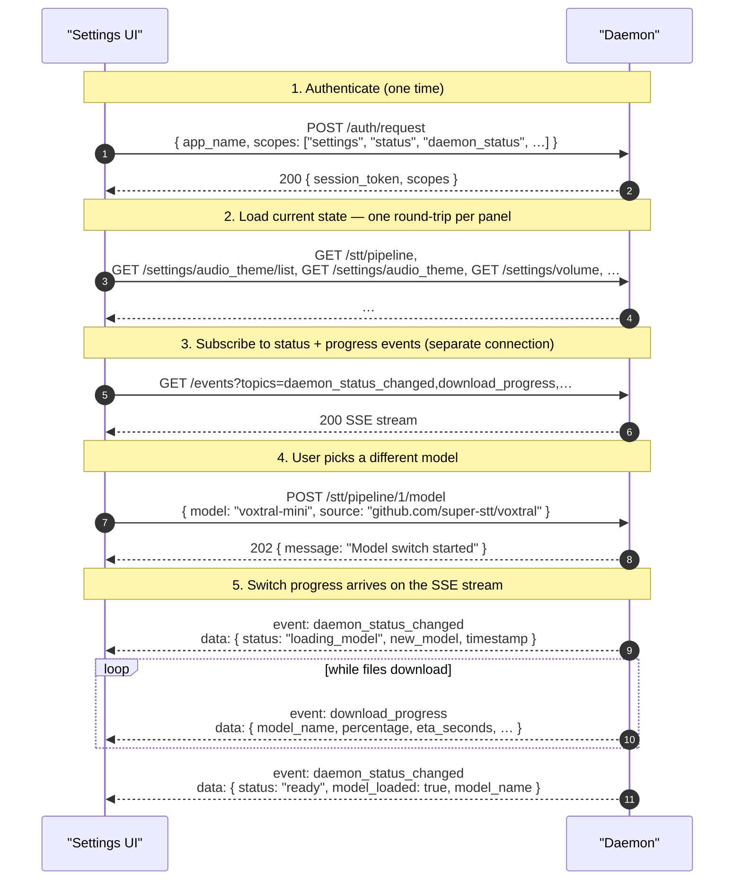

# settings scope

> Scope: **settings** (full read/write access to daemon configuration and the
> backend registry).

The `settings` scope is the configuration surface: a `settings` token can read
every daemon configuration value, change any of them, persist the change to disk,
and manage installed backends through the registry. It covers a backend's
non-sensitive **options**; a backend's **secrets** (API keys) are managed
separately under the [`secrets`](./secrets.md) scope and are never readable.

It grants **only** that surface — scopes no longer imply one another. A Settings
UI that also drives test recordings or test speech, shows daemon status, or
renders a visualizer requests those scopes *alongside* `settings` in the same
handshake, e.g.
`["settings", "status", "transcribe", "recording_events", "speak", "playback_events", "audio_visualization", "daemon_status"]`.
See [auth.md](../auth.md) for how scopes compose, and the individual scope docs
([status](./status.md), [transcribe](./transcribe.md),
[recording_events](./recording_events.md), [speak](./speak.md),
[playback_events](./playback_events.md),
[audio_visualization](./audio_visualization.md),
[daemon_status](./daemon_status.md)) for what each adds.

Transport and framing are described in [transport.md](../transport.md).

## What gets mirrored on `/events`

Settings mutations have **two** observable wire effects: the HTTP response on the
request that made them, and (for model/device transitions) follow-up SSE events
on any `GET /events` subscription that holds the [`daemon_status`](./daemon_status.md)
scope and asked for `daemon_status_changed` or `download_progress`.

| Mutation                                                                                                                          | Mirrored as an SSE event?                                                                            |
|-----------------------------------------------------------------------------------------------------------------------------------|------------------------------------------------------------------------------------------------------|
| `/stt/pipeline/{stage}/model`, `/stt/pipeline/{stage}/model/{model}/device` (when it reloads), and the same under `/tts/pipeline` | Yes — `daemon_status_changed` (and `download_progress` while files are being pulled). Each names the `feature` it is about; speech to text's also carry the `stage`, since every stage reports its own model lifecycle. Text to speech has one stage, so its events carry no `stage`. |
| `/stt/pipeline/1`, `/tts/pipeline/1` (backend selection)                                                                            | Yes — `daemon_status_changed` (`active_backend_changed` variant)                                      |
| `/settings/language`, `/settings/idle_unload`, `/settings/update_check_enabled`, `/settings/update_beta_optin`, `/stt/pipeline/{stage}` (post-processing stages), every write under `/stt/context` and `/stt/backend/{backend_id}/context`                                     | Yes — `daemon_status_changed` (`settings_changed` variant, carrying which setting changed)            |
| `/settings/audio_theme`, `/settings/volume`, `/settings/write_method`, `/settings/read_method`, `/settings/notification_method`, `/settings/recording_stop_mode`, `/settings/preview_typing` | No. Clients that want to see *another* app change one of these must re-`GET` the relevant endpoint.  |

## Endpoint reference

| Endpoint                                                    | Methods    | Notes                                                                                                |
|-------------------------------------------------------------|------------|------------------------------------------------------------------------------------------------------|
| [`/stt/pipeline/{stage}/model/list`](../endpoints/v1/pipeline/model-list.md) | GET | The models a stage can run: its backend's, carrying its role |
| [`/settings/language`](../endpoints/v1/settings/language.md)                  | GET, POST, DELETE | Global Primary Language (BCP-47 tag / `auto` / unset)                          |
| [`/settings/language/list`](../endpoints/v1/settings/language/list.md)        | GET        | The tags `POST /settings/language` accepts, plus `auto`                                     |
| [`/settings/audio_theme`](../endpoints/v1/settings/audio_theme.md)            | POST, GET  | Set / read the audio cue theme                                                                        |
| [`/settings/audio_theme/test`](../endpoints/v1/settings/audio_theme/test.md)  | POST       | Audition the current theme's start + stop cues                                                        |
| [`/settings/audio_theme/list`](../endpoints/v1/settings/audio_theme/list.md)          | GET        | List available themes                                                                                  |
| [`/settings/volume`](../endpoints/v1/settings/volume.md)                      | POST, GET  | Set / read audio cue volume (0–100)                                                                   |
| [`/settings/recording_stop_mode`](../endpoints/v1/settings/recording_stop_mode.md) | POST, GET | Default stop behavior for `/stt/transcribe` (silence_only / silence_and_manual / manual_only)                  |
| [`/settings/preview_typing`](../endpoints/v1/settings/preview_typing.md)      | POST, GET  | Toggle live typing of preview text while recording                                                    |
| [`/stt/pipeline`](../endpoints/v1/pipeline.md)                  | GET        | The ordered stages a transcript passes through                                                        |
| [`/stt/pipeline/{stage}`](../endpoints/v1/pipeline/stage.md)          | GET, POST, DELETE | Select / deselect the backend filling one stage                                                |
| [`/stt/pipeline/{stage}/model`](../endpoints/v1/pipeline/model.md)    | POST, DELETE | Run / stop a model in one stage                                                                     |
| [`/stt/pipeline/{stage}/model/cancel`](../endpoints/v1/pipeline/model.md#post-sttpipelinestagemodelcancel) | POST   | Abort an in-flight load for one stage                                                             |
| [`/stt/pipeline/{stage}/model/reload`](../endpoints/v1/pipeline/model.md#post-sttpipelinestagemodelreload) | POST   | Re-instantiate a stage in place, applying changed secrets/options                                 |
| [`/stt/pipeline/{stage}/model/{model}/device`](../endpoints/v1/pipeline/device.md#get-sttpipelinestagemodelmodeldevice) | GET, POST | Read / set the device one of a stage's models runs on (cpu / gpu)                    |
| [`/stt/pipeline/{stage}/model/{model}/device/list`](../endpoints/v1/pipeline/device.md#get-sttpipelinestagemodelmodeldevicelist) | GET | The devices this install can run one of a stage's models on                     |
| [`/stt/pipeline/{stage}/device/list`](../endpoints/v1/pipeline/device.md#get-sttpipelinestagedevicelist) | GET | The devices this install can run a stage's backend on                                 |
| [`/stt/pipeline/{stage}/model/{model}/language`](../endpoints/v1/pipeline/language.md) | GET, POST, DELETE | Per-model language override + resolved effective language |
| [`/tts/pipeline`](../endpoints/v1/tts/pipeline.md)                  | GET        | The stages an utterance passes through. Stage 1 is synthesis, and the only stage                      |
| [`/tts/pipeline/{stage}`](../endpoints/v1/tts/pipeline/stage.md)    | GET, POST, DELETE | Read / select / clear the backend filling one stage                                            |
| [`/tts/pipeline/{stage}/backend/list`](../endpoints/v1/tts/pipeline/backend-list.md) | GET | The backends that can fill this stage                                              |
| [`/tts/pipeline/{stage}/device/list`](../endpoints/v1/tts/pipeline/device.md#get-ttspipelinestagedevicelist) | GET | The devices this install can run the stage's backend on             |
| [`/tts/pipeline/{stage}/model`](../endpoints/v1/tts/pipeline/model.md) | GET, POST, DELETE | Read the stage's model and any in-flight switch; run one; stop it               |
| [`/tts/pipeline/{stage}/model/list`](../endpoints/v1/tts/pipeline/model-list.md) | GET | The models this stage can run — its backend's                                            |
| [`/tts/pipeline/{stage}/model/cancel`](../endpoints/v1/tts/pipeline/model.md#post-ttspipelinestagemodelcancel) | POST | Abort an in-flight model load for one stage                       |
| [`/tts/pipeline/{stage}/model/reload`](../endpoints/v1/tts/pipeline/model.md#post-ttspipelinestagemodelreload) | POST | Re-instantiate a stage in place, applying changed secrets/options |
| [`/tts/pipeline/{stage}/model/{model}/device`](../endpoints/v1/tts/pipeline/device.md) | GET, POST | Read / set the device one of a stage's models runs on (cpu / gpu)          |
| [`/tts/pipeline/{stage}/model/{model}/device/list`](../endpoints/v1/tts/pipeline/device.md#get-ttspipelinestagemodelmodeldevicelist) | GET | The devices this install can run that model on |
| [`/tts/pipeline/{stage}/model/{model}/language`](../endpoints/v1/tts/pipeline/language.md) | GET, POST, DELETE | Per-model language override + resolved effective language      |
| [`/tts/pipeline/{stage}/model/{model}/language/list`](../endpoints/v1/tts/pipeline/language.md#get-ttspipelinestagemodelmodellanguagelist) | GET | The language tags that model accepts |
| [`/tts/pipeline/{stage}/model/{model}/voice`](../endpoints/v1/tts/pipeline/voice.md) | GET, POST, DELETE | Read / set / clear the voice a model speaks in when an utterance names none |
| [`/tts/pipeline/{stage}/model/{model}/voice/list`](../endpoints/v1/tts/pipeline/voice.md#get-ttspipelinestagemodelmodelvoicelist) | GET | The voices that model could be set to |
| [`/settings/write_method`](../endpoints/v1/settings/write_method.md)          | POST, GET  | Keyboard simulation method (auto / built_in / xdg_desktop_portal / ydotool)                   |
| [`/settings/write_method/test`](../endpoints/v1/settings/write_method/test.md) | POST      | Type a test string with the configured method; reports the backend it resolved to                     |
| [`/settings/notification_method`](../endpoints/v1/settings/notification_method.md) | POST, GET  | How recording and synthesis failures are surfaced (auto / desktop / typed / off)                      |
| [`/settings/read_method`](../endpoints/v1/settings/read_method.md)            | POST, GET  | Where `/tts/speak/read` reads from (selection / clipboard)                                            |
| [`/backend/list`](../endpoints/v1/backends.md)                  | GET, DELETE | List installed backends; uninstall a backend                                                  |
| [`/backend/{backend_id}/option/list`](../endpoints/v1/backends/options.md) | GET, POST, DELETE | List / read / set / reset a backend's non-sensitive options                          |
| [`/stt/context/list`](../endpoints/v1/context.md)                       | GET        | The dictation contexts the user has, and which is active                                      |
| [`/stt/context/{id}`](../endpoints/v1/context.md)                       | GET, POST, DELETE | Read / create / replace / delete one dictation context                                 |
| [`/stt/context/active`](../endpoints/v1/context.md)                     | GET, POST  | Which context is in force by default                                                          |
| [`/stt/backend/{backend_id}/context`](../endpoints/v1/context.md)       | GET, POST, DELETE | Point one backend at a context of its own, at none, or back at the active one          |
| [`/gpu_info`](../endpoints/v1/gpu_info.md)                  | GET        | GPU / VRAM information                                                                                 |
| [`/registry/backend/list`](../endpoints/v1/registry/backends.md) | GET      | List backends available in the registry                                                               |
| [`/registry/backend/preview`](../endpoints/v1/registry/preview.md) | POST | Describe what a source would install, without installing it                                           |
| [`/registry/backend/refresh`](../endpoints/v1/registry/refresh.md) | POST | Refresh the registry index                                                                            |
| [`/registry/backend/install`](../endpoints/v1/registry/install.md) | POST | Install a backend from the registry                                                                   |
| [`/registry/backend/update`](../endpoints/v1/registry/update.md) | POST | Update an installed registry backend                                                                  |
| [`/update`](../endpoints/v1/update.md) | GET | Self-update availability (daemon version vs latest release) |
| [`/update/check`](../endpoints/v1/update/check.md) | POST | Force an immediate self-update check |
| [`/settings/idle_unload`](../endpoints/v1/settings/idle_unload.md) | POST, GET | How long an unused model stays loaded before it is unloaded (`0` keeps models loaded) |
| [`/settings/update_check_enabled`](../endpoints/v1/settings/update_check_enabled.md) | POST, GET | Toggle / read the daemon's periodic self-update check |
| [`/settings/update_beta_optin`](../endpoints/v1/settings/update_beta_optin.md) | POST, GET | Whether prerelease versions are considered for updates (auto / enabled / disabled) |

`{backend_id}` is the backend's repository `source`, percent-encoded. `{stage}`
is a pipeline position: `/stt/pipeline` has `1` (transcription) and `2`
(post-processing), `/tts/pipeline` has `1` (synthesis), and any other position
answers `404 unknown_stage` naming the ones that exist.

## A typical settings session

A settings UI usually opens two HTTP connections in parallel: one-shot
connections for each read or write, plus a long-lived SSE connection for
`/events`. The SSE channel carries running model-switch progress so the UI's
progress bar updates without polling — which is why the handshake also requests
[`daemon_status`](./daemon_status.md).

Settings mutations that aren't mirrored on `/events` (the non-model row of the
table at the top) won't trigger SSE events; a settings UI that wants to detect
another app changing those needs to re-`GET` the relevant endpoint.
